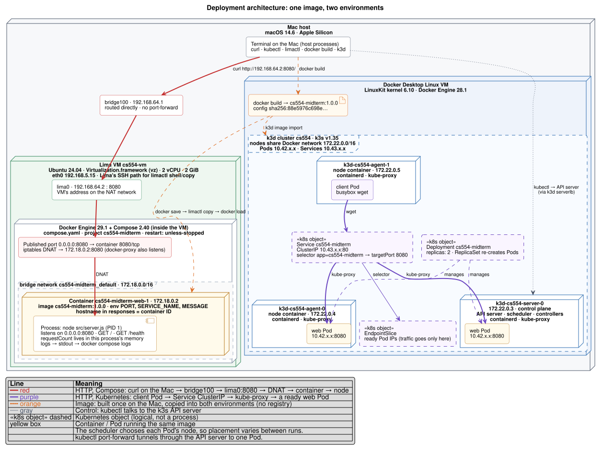

# Technical Report: One Service, Two Deployment Environments

CS 554 Midterm Mini-Project · Bibek Adhikari · Evidence: [EVIDENCE.md](EVIDENCE.md) · Setup: [README.md](README.md)

## 1. System and layers

- One image, `cs554-midterm:1.0.0`, runs in both environments.
- Its digest `sha256:88e5976c698e…` is the same on the Mac, in the VM and in the k3d nodes.
- So both environments run the exact same image.

| Layer | Environment 1: Compose | Environment 2: Kubernetes |
| --- | --- | --- |
| Physical host | MacBook Pro, Apple Silicon, macOS 14.6 | Same Mac |
| Virtual machine | Lima VM `cs554-vm`, Ubuntu 24.04, 2 CPU / 2 GiB | Docker Desktop's Linux VM |
| Container runtime | Docker 29.1 + Compose 2.40 in the VM | k3d: 3 nodes, each a Docker container running k3s |
| Container | `cs554-midterm-web-1` | Container `web` in each of 2 Pods |
| Process | `node src/server.js` | Same, one per Pod |

**What this means**

- Each layer starts and stops on its own.
- Example: the VM can be running while the container is stopped.
- `hostname` in the reply = container ID (Compose) or Pod name (Kubernetes).
- `requestCount` belongs to one process. When the process is replaced, it starts again from 0.

## 2. Deployment diagram



## 3. Docker Compose inside the VM

**VM and network**

- The VM runs with Lima on Apple's virtualization.
- It got the address `192.168.64.2` on the Mac's private network.
- The Mac reaches this address directly. No port forwarding is used.
- No Mac folders are shared with the VM. Files were copied in with `limactl copy`.
- Why not Multipass (used in class)? It crashed on macOS 14.6. Its QEMU needs macOS 15.4 or newer.

**Service, status and logs**

- `compose.yaml` sets `PORT`, `SERVICE_NAME=compose-in-vm` and `MESSAGE`.
- It maps port `8080:8080`.
- It has `restart: unless-stopped` and a health check.
- `docker compose ps` showed `Up (healthy)`.
- `/health` returned `200 {"status":"ok"}`.
- `/` returned JSON with the container's hostname.
- A call from the Mac to `http://192.168.64.2:8080/` reached the same container. The count kept going up.
- Logs show `Listening on port 8080` and one line per request.

**Restart**

- `docker compose restart web` kept the **same** container.
- Same hostname, 0 restarts, new start time.
- Logs show `Received SIGTERM; stopping.` then `Listening on port 8080`.
- The next request returned `requestCount: 1`.
- So the count lives in the process. It does not live in the container or the VM.

**Crash and recreate**

- I killed the process with `kill -9`.
- Docker restarted the same container (`restarts=1`). The count started at 1 again.
- `docker compose down` then `up` made a **new** container. The hostname changed and the count started at 1.

## 4. Kubernetes: what the evidence shows

**Where the cluster runs**

- k3d runs on the Mac inside Docker Desktop's VM. It is separate from the Lima VM.
- No registry is used. `k3d image import` copies the image into every node.
- `imagePullPolicy: Never` makes it fail fast if the image is missing. It will not try Docker Hub.

**Two ready replicas**

- The Deployment shows `2/2`.
- Both Pods show `1/1 Running`.
- The EndpointSlice lists both Pod IPs as `ready=true`.

**Two ways to call the service**

- **From inside the cluster:** a client Pod calls `http://cs554-midterm/`.
  - kube-proxy sends each new connection to a ready Pod.
  - Both Pod names show up, each with its own counter.
- **With port-forward:** `kubectl port-forward svc/cs554-midterm`.
  - It picks **one** Pod at the start and stays on it.
  - It proves the selector and port are right.
  - It does **not** prove load balancing.

**Pod replacement**

- The Deployment was set to 2 replicas. I deleted one Pod.
- The old Pod got SIGTERM and exited cleanly (code 0).
- A new Pod was created and became ready.
- The Deployment went back to `2/2`.
- The new Pod had a new name, a new IP, and a counter starting at 1.
- ReplicaSet events show `SuccessfulCreate`.

**Why Kubernetes replaces the Pod**

- A Deployment stores the **desired state**: 2 replicas.
- Its ReplicaSet keeps counting the matching Pods.
- After the delete it saw only 1, so it made a new one.
- The scheduler picked a node for it.
- The old Pod was not restarted. It was **replaced**.

**Compared with Compose**

- `docker compose restart` only runs when I run it.
- It restarts the **same** container. Hostname stays, counter resets.
- Docker's restart policy brings back a crashed container, but only on the same machine.
- Compose has no controller keeping a replica count.
- If the VM stops, nothing runs the service anywhere else.
- In both cases the counter resets, because a new process always starts at 0.

## 5. Troubleshooting: broken Service selector

**Before (working)**

- Service selector: `app: cs554-midterm`.
- Both Pods have the label `app=cs554-midterm`.
- EndpointSlice has 2 ready endpoints.
- Requests from inside the cluster and through port-forward both worked.

**What I changed (only the Service)**

```bash
kubectl patch service cs554-midterm --type=merge -p '{"spec":{"selector":{"app":"cs554-midterm-typo"}}}'
```

**What the client saw**

- Requests in the cluster failed: `wget: can't connect to remote host (10.43.x.x): Connection refused`.
- A **new** port-forward failed: `error: timed out waiting for the condition`.

**What I checked**

1. Deployment still `2/2`. Both Pods still `1/1 Running` with the right label.
2. The Service selector was now `app=cs554-midterm-typo`. No Pod has that label.
3. EndpointSlice was empty: `PORTS <unset>  ENDPOINTS <unset>`.
4. Calling a Pod IP directly still returned 200. So the app was fine.

**Cause**

- A Service is not tied to a Deployment directly.
- It finds Pods only by its label selector.
- No Pod matched, so the endpoint list became empty.
- kube-proxy refuses connections to a Service with no endpoints. That is why we saw *refused* and not a timeout.
- Port-forward had no Pod to connect to.

**Fix**

- `kubectl apply -f k8s.yaml` showed `deployment unchanged` and `service configured`.
- The EndpointSlice listed both Pods as ready again.
- Requests in the cluster showed both hostnames again.
- A new port-forward worked again.

**Lesson: healthy Pods are not enough**

- Pod health only tells you about the Pod.
- To reach it through a Service you also need:
  - the selector to match the Pod labels
  - a filled endpoint list
  - `targetPort` to match the container port
  - DNS
  - kube-proxy rules
- These parts connect only through labels.
- In this test, every Pod check was green while every Service request failed.

##  Resources and readiness

**Requests and limits (per container)**

| | CPU | Memory |
| --- | --- | --- |
| Request | 50m | 64 Mi |
| Limit | 250m | 128 Mi |

- **Request** = what the scheduler reserves.
  - A Pod only goes on a node with that much free space.
  - `kubectl describe node` shows 50m / 64Mi reserved even when the Pod is idle.
- **Limit** = a hard ceiling set by the Linux kernel (cgroups).
  - CPU above 0.25 core gets slowed down (`cpu.max` is `25000 100000`).
  - Memory above 128 Mi gets the process killed (OOM).
- Requests are lower than limits, so the Pods are in the **Burstable** QoS class.

**Why these numbers**

- After 300 requests per Pod, usage was under 10m CPU and about 21 MiB memory.
- 64 Mi covers that with room to grow, without reserving too much.
- 128 Mi gives extra room for page cache and still stops a memory leak.
- 250m stops one bad replica from using too much CPU.

**Readiness test**

- The probe calls `GET /health` every 5 seconds.
- 2 failures in a row mark the Pod NotReady.
- I ran `touch /tmp/not-ready` in **one** Pod only.
- Results:
  - That Pod showed `0/1 Running` with 0 restarts.
  - The kubelet logged `HTTP probe failed with statuscode: 503`.
  - Its EndpointSlice entry became `ready=false`.
  - All 8 requests through the Service went to the other Pod.
  - A direct request to the NotReady Pod still worked.
- Deleting the file brought it back to `ready=true`. Traffic went to both Pods again.
- `generation=1` shows I never edited the Deployment template.

**Readiness vs restart**

- Readiness only decides if a Pod gets Service traffic.
- A restart (crash or failed liveness probe) replaces the process.
- The NotReady Pod's counter kept going up. It did not reset to 1.
- So its process was never replaced.

## 7. OpenStack deployment plan

### Resources

| Resource | Choice | Who provides it |
| --- | --- | --- |
| Image | `ubuntu-24.04` (Glance) | Instructor |
| Flavor | `m1.small` | Instructor |
| Key pair | `cs554-key` from my public key | Me |
| Network / subnet | `private` / `private-subnet` | Class project (or I create them) |
| Router | `router1`, connected to network `public` | Class project |
| Security group | `cs554-web`: TCP 8080 open, TCP 22 only from my IP | Me |
| Floating IP | From `public`, attached to the VM | Me |
| Instance | `cs554-openstack`, with cloud-init | Me |

**Why `m1.small`**

- It has 1 CPU, 2 GB RAM and 20 GB disk (check with `openstack flavor show`).
- The service uses about 21 MiB.
- Ubuntu + Docker need a few hundred MB.
- My local VM ran fine with 2 GB.
- `m1.tiny` is too small for Docker.

**No disk volume (Cinder) needed**

- The service stores nothing.
- The counter is in memory on purpose.
- cloud-init can rebuild everything.

### What each OpenStack service does

- **Keystone:** logs me in and gives a token and the list of service addresses.
- **Glance:** stores the Ubuntu image.
- **Nova:** checks the flavor and image, picks a compute host, boots the VM, and passes in my key and cloud-init script.
- **Neutron:** creates the network port, gives the private IP, applies the security group, and handles the router and floating IP.

**Running Compose on the VM**

- cloud-init installs `docker.io` and `docker-compose-v2`.
- It writes `compose.yaml`, gets the image and runs `docker compose up -d`.
- One change: my image is arm64, but class servers are likely x86-64.
- So I would build for both with `docker buildx build --platform linux/amd64,linux/arm64`.
- Then push it to a registry the VM can reach, like GHCR.

### Request path

1. Client calls `FLOATING_IP:8080`.
2. It goes through the `public` network.
3. `router1` changes it to the private IP.
4. The security group allows TCP 8080 (replies are allowed back automatically).
5. It reaches VM port 8080.
6. Docker forwards it to container port 8080.
7. The Node process answers.

**Required rule**

```bash
openstack security group rule create --ingress --protocol tcp --dst-port 8080 cs554-web
```

- SSH (port 22) is a separate rule for admin use. It does not open the app.
- Ping (ICMP) is optional. A working ping does not mean port 8080 is open.

### If it does not work: what to check

Go from the inside out, one layer at a time:

1. **Cloud:** `openstack server show` (is it ACTIVE?) and `openstack console log show` (did cloud-init finish?).
2. **Container and app** (over SSH): `docker compose ps`, `docker compose logs web`, `curl localhost:8080/health`.
   - Failing here = app problem.
   - Example: `exec format error` means the image is for the wrong CPU type.
3. **VM:** `ss -ltnp` should show `0.0.0.0:8080`. Try `curl FIXED_IP:8080`. Check the VM firewall.
4. **Cloud network:** `curl` the private IP from another VM. Then check port, security group rules, floating IP and router.
5. **Client:** use `curl -v`.
   - *Timeout* = something drops the packet (security group or routing).
   - *Connection refused* = the packet arrived, but nothing is listening.

### Using a cloud vs running a cloud

- **Using** a working cloud = calling APIs that already work.
- **Running** a cloud = keeping many parts healthy:
  - Keystone, Glance, Nova, Placement, Neutron
  - the database and message queue
  - the hypervisor and host network
- If one part breaks, every user is affected.

**Two kinds of problems**

- **Infrastructure problem:** affects every VM. Only the cloud operator can fix it.
  - Example: DevStack floating IPs not reachable from a laptop. The external network is virtual and needs host routes or NAT.
- **App deployment problem:** affects only my VM. I can fix it myself.
  - Example: forgetting the security group rule for port 8080.

### When is a VM with Compose enough?

- **Compose is enough:** one instance, and some downtime is OK. For example, a demo.
- **Kubernetes added:**
  - automatic replacement of a deleted Pod
  - a stable Service in front of changing Pod IPs
  - readiness that removes one replica from traffic without a restart
  - CPU and memory limits per container
- **But Kubernetes also added new ways to fail**, like the selector mismatch.

## References

1. Course materials, UAH CS 454/554: Exercises 02 (local VM), 04 (local Kubernetes), 05 (OpenStack IaaS), `OPENSTACK-SETTINGS.md`, `OPTIONAL-LOCAL-DEVSTACK.md`, `RESTRICTED-NETWORKS.md`. https://github.com/UAH-Computer-Science/cs454-Course-Exercises
2. Kubernetes documentation: Deployments, ReplicaSet, Service, EndpointSlices, Probes, Resource Management, Pod QoS Classes. https://kubernetes.io/docs/concepts/
3. Docker documentation: Compose file reference, restart policies, packet filtering and firewalls. https://docs.docker.com/
4. k3d documentation (`k3d image import`). https://k3d.io/
5. Lima documentation (`vz` VM type, `vzNAT` networking). https://lima-vm.io/docs/
6. OpenStack documentation: Keystone, Glance, Nova, Neutron, OpenStackClient. https://docs.openstack.org/
7. Linux kernel, Control Group v2 (`memory.max`, `cpu.max`, `memory.stat`). https://docs.kernel.org/admin-guide/cgroup-v2.html
